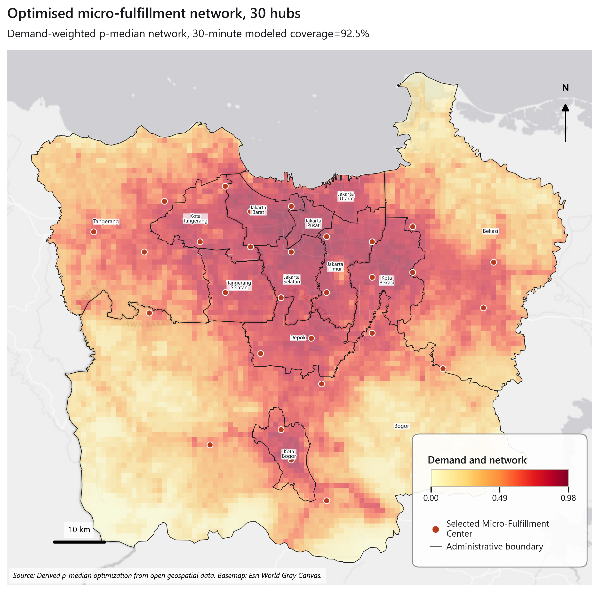
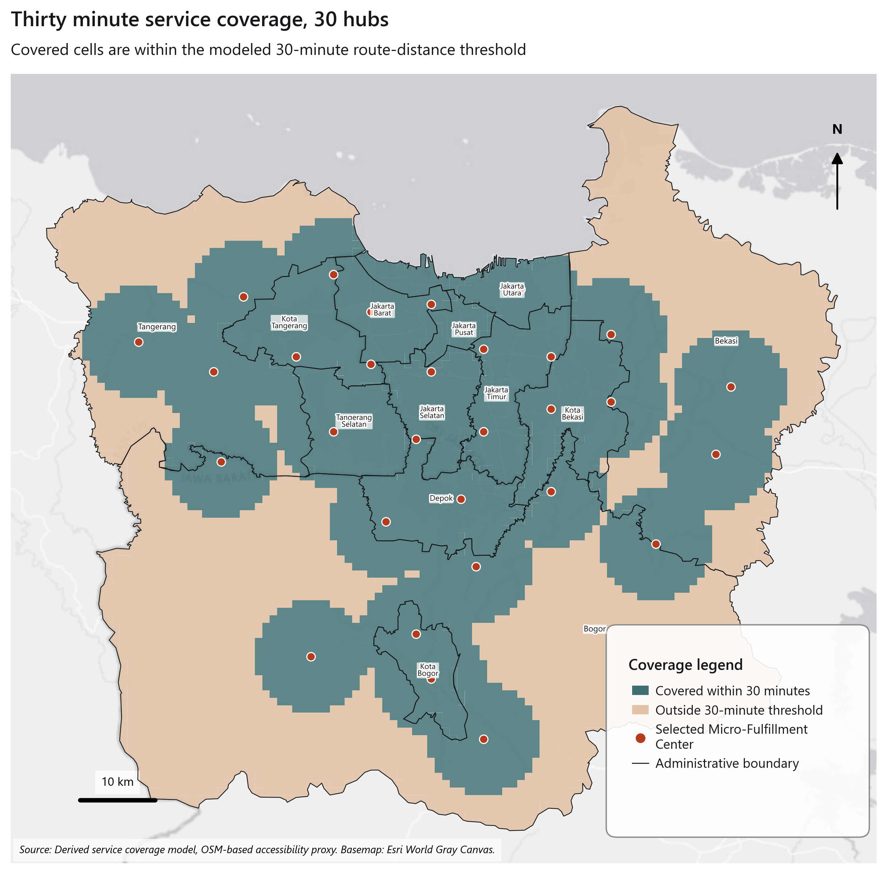
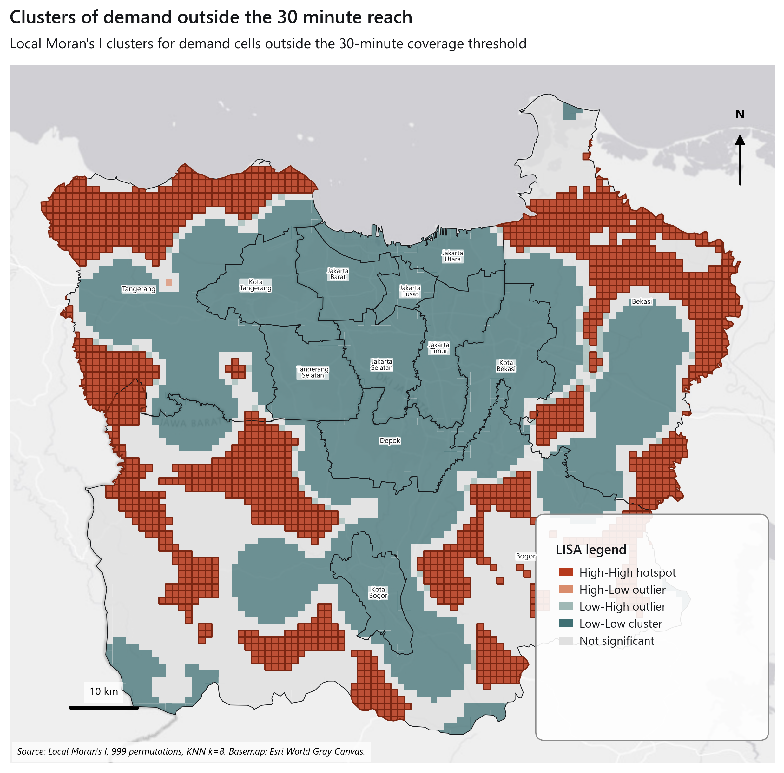
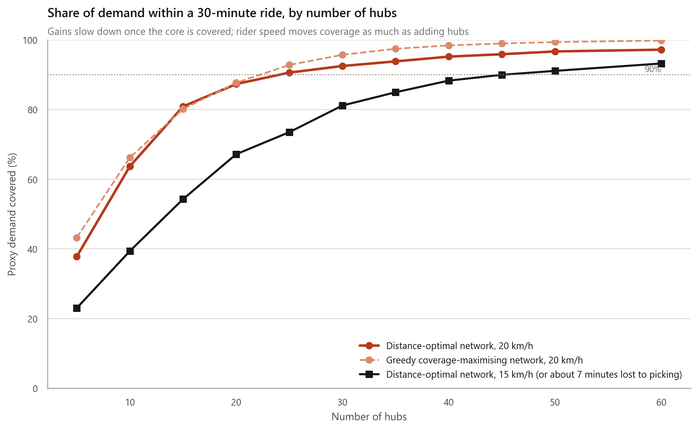
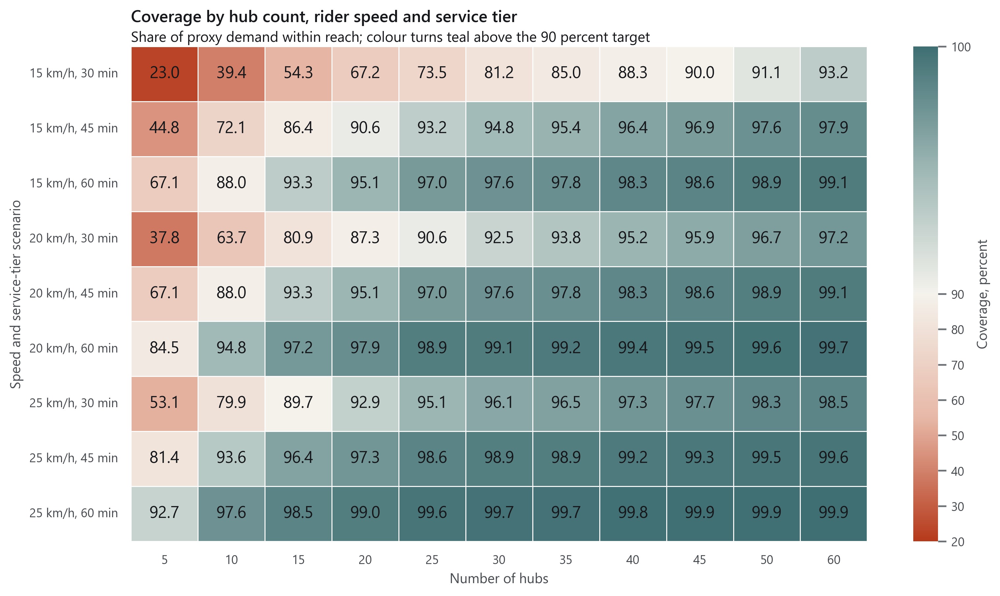
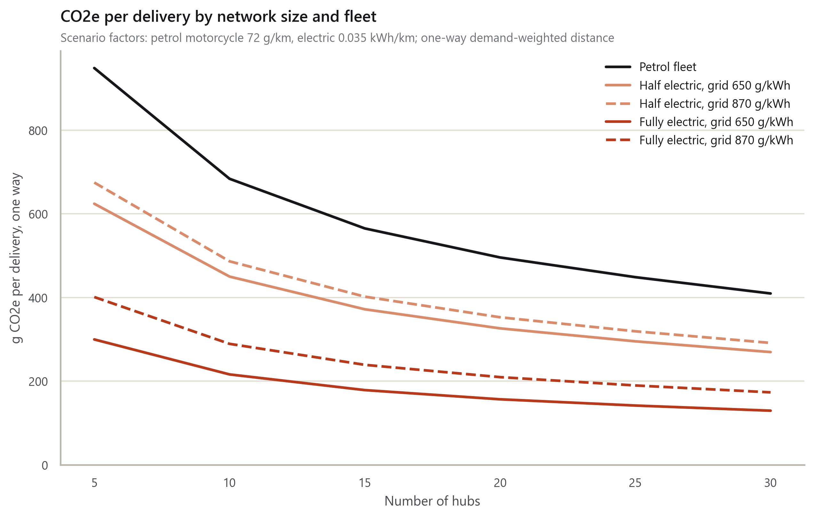
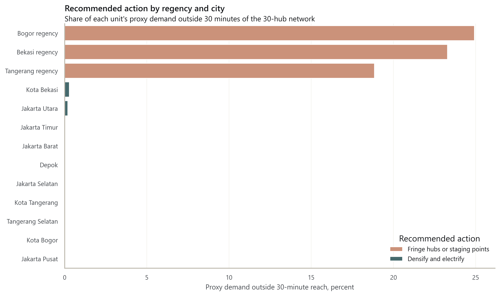

# Micro-Fulfillment Network Optimization for Quick-Commerce Decarbonization in Greater Jakarta

Open-data geospatial optimization framework for evaluating micro-fulfillment center (MFC) network design, 30-minute service coverage, underserved spatial clusters, and last-mile CO2e reduction scenarios for quick-commerce operations in Greater Jakarta.

The pipeline combines Google Earth Engine, WorldPop, VIIRS nighttime lights, Dynamic World, OpenStreetMap, p-median and maximal-covering facility location, Moran's I, LISA hotspot analysis, and CO2e scenario modeling in a reproducible Python pipeline.

## Executive Takeaway

Thirty-minute quick commerce across Greater Jakarta is a question of how many hubs, not a hard limit.

With every demand cell counted and every built-up cell allowed as a candidate site, coverage keeps rising as hubs are added: 30 hubs reach 81.6 percent of proxy demand within 30 minutes and 40 hubs pass 90 percent. The last tenth of demand sits in the Bogor, Bekasi and Tangerang regencies, where a longer service tier or rider staging points are cheaper than the extra hubs full coverage needs. Distance reduction does most of the decarbonisation work; electrifying the fleet on top of it adds the rest.

## Key Results

* 30 optimized MFCs cover 81.6% of proxy demand within 30 minutes at 20 km/h.
* 40 MFCs reach 91.9% and 60 MFCs 98.0%. A network optimized for coverage rather than distance reaches almost the same values (82.5% at 30 hubs), so the distance-optimal network gives up little coverage.
* 30 MFCs reduce demand-weighted last-mile distance by 82.7% against a single central fulfillment hub.
* 30 MFCs plus 50% electric motorcycle adoption reduce scenario CO2e by 88.6% per 100,000 proxy deliveries; with 100% EV adoption, 94.5%.
* With 30 MFCs, a 45-minute tier at 20 km/h reaches 98.4% coverage.
* Demand is strongly clustered (Moran's I = 0.944); demand left outside the 30-minute reach is also clustered (Moran's I = 0.621), both p = 0.001.
* The largest volumes of uncovered demand are in the Bogor regency (30% of its demand), the Bekasi regency (27%) and North Jakarta (22%).

## Correction, September 2026

An earlier version of this README reported 76.3% coverage with 30 hubs, a "coverage ceiling" of 76.8% at 60 hubs, and concluded that adding MFCs cannot solve 30-minute coverage. That conclusion was an artifact of the setup, not a property of Greater Jakarta:

* only the 2,500 highest-demand cells (57% of proxy demand) entered the optimization, and coverage was reported as a share of that subset;
* candidate sites were limited to 350 points in the top 30% of demand, and 76.8% was exactly the coverage reached with all 350 open.

The optimization now uses all 7,096 demand cells, all 3,792 built-up cells as candidates, greedy construction improved by vertex substitution, and a maximal-covering comparison. The previous outputs are archived outside the repository.

## Study Area

The study area is the road-based Greater Jakarta metropolitan logistics region generated from GADM 4.1 administrative boundaries. It includes DKI Jakarta and adjacent urban jurisdictions in Tangerang, Bekasi, Bogor, and Depok. Kepulauan Seribu is excluded because the analysis focuses on road-based last-mile logistics.

## Important Interpretation Boundary

Demand in this project is a latent open-data proxy, not actual platform order volume. The demand proxy is derived from WorldPop population, VIIRS nighttime lights, Dynamic World built-up probability, OpenStreetMap road accessibility and OpenStreetMap commercial POI density.

Emissions are scenario-based per 100,000 proxy deliveries, not measured company emissions. The grid emission factor is an assumption (650 gCO2e/kWh); at 870 gCO2e/kWh, closer to published Java-Bali grid values, the 30-hub, 50%-EV reduction falls from 88.6% to about 87.7%. Distance is corrected Euclidean distance (detour factor 1.35), not live time-dependent routing.

## Method Overview

1. Generate the Greater Jakarta AOI from GADM 4.1.
2. Preprocess raster data in Google Earth Engine.
3. Build a 1 km open-data quick-commerce demand proxy.
4. Take every built-up cell (Dynamic World built-up probability at least 0.20) as a candidate MFC site.
5. Optimize MFC networks with a demand-weighted p-median (greedy construction plus vertex substitution) over all demand cells, and compare with a greedy maximal-covering solution.
6. Evaluate 30-minute service coverage, CO2e scenarios, and spatial clustering of uncovered demand.
7. Run sensitivity analysis for MFC count, speed, and service tier.

## Visual Evidence and Interpretation

### 1. Optimized Micro-Fulfillment Network



The 30-hub network cuts demand-weighted distance by 82.7% against a central hub.

### 2. Thirty-Minute Service Coverage



81.6% of proxy demand sits within 30 minutes of the 30-hub network at 20 km/h. The uncovered remainder is on the fringes.

### 3. Underserved Demand Hotspots



Uncovered demand clusters spatially (Moran's I = 0.621, p = 0.001), mostly in the Bogor, Bekasi and Tangerang regencies.

### 4. MFC Count Sensitivity



Coverage rises from 19.5% with 5 hubs to 81.6% with 30, 91.9% with 40 and 98.0% with 60. There is no plateau in this range.

### 5. Speed and Service-Tier Sensitivity



A 45-minute tier lifts the 30-hub network from 81.6% to 98.4% coverage at 20 km/h, which is the cheaper route to near-full coverage than doubling the network.

### 6. CO2e Reduction Pathway



Shorter distance delivers most of the reduction; electrification compounds it.

### 7. Administrative Action Typology



Units are classed by demand intensity and by the share of their demand outside the 30-minute reach of the 30-hub network.

## Strategic Recommendations

### Core urban areas

Most demand in Jakarta, Kota Tangerang, Tangerang Selatan, Depok, Kota Bekasi and Kota Bogor is already inside the 30-minute reach. Densify inventory, electrify the fleet and improve charging access. North Jakarta is the exception, with 22% of its demand outside the reach, and warrants additional core hubs.

### Fringe regencies

The Bogor and Bekasi regencies hold the largest uncovered volumes. Add hubs inside contiguous uncovered clusters, use rider staging points, and offer a 45-minute tier where hubs are not justified.

## Reproducing

```bash
python scripts/21_run_pipeline.py --skip-gee-auth
python scripts/run_enhanced_analysis.py
```

Steps 01 to 08 need Earth Engine credentials; from step 09 onward the pipeline runs on data already on disk.
